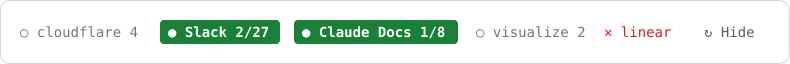

# mcp-lights

A Claude Code mod that shows the session's MCP servers as chips in a strip above the prompt box. It works in the desktop app's Code tab and in the terminal.



```
○ cloudflare 4   ● Slack 2/27   ● Claude Docs 1/8   ○ visualize 2   ✕ linear   ↻  Hide
```

- **Idle** `○ Slack 27`: the server is connected and has 27 tools.
- **Running** `● Slack 2/27`: the chip glows green while the server's tools run. The first number is the count of calls in flight, updated live.
- **Not connected** `✕`: the server failed or needs sign-in.
- **↻** reloads the server list after you change connectors. **Hide** hides the strip for the current session.

The app's internal servers appear only while one of their tools is running.

## Install

Type this at the prompt of a Claude Code session running in a terminal:

```
/plugin install mcp-lights --marketplace milroyfraser/mcp-lights
```

Answer `y` to add the marketplace, then choose the **user** scope. It then loads in every new session, desktop Code tab sessions included. The desktop Code tab can't run this command, so use a terminal.

## How it works

- At session start the mod reads the server list (names, status and tool counts). In the desktop app it uses the app's connector-status tool, and that call may appear as one row in the transcript. Elsewhere it groups `mcp__<server>__<tool>` names from the tool list.
- A `tool.call` hook counts each `mcp__<server>__*` call up when it starts and down when it ends. If the hook fails, the call still goes ahead.

## Develop

```
claude plugin validate .
claude plugin test .
```

## License

MIT
